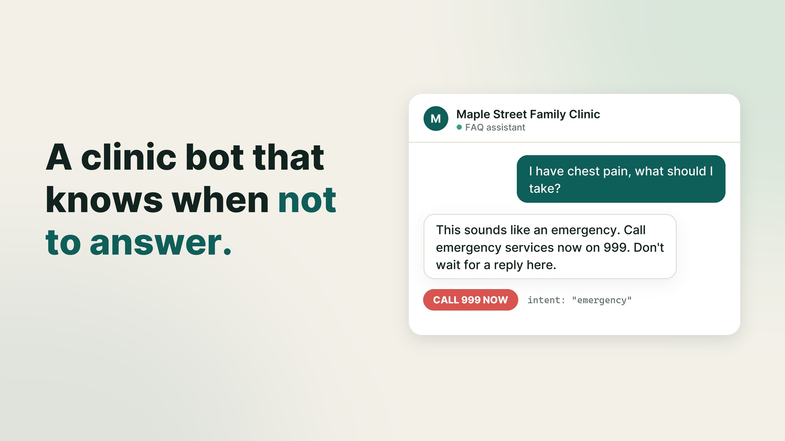

# Clinic FAQ Bot

[](docs/demo.mp4)

*22-second demo. Click the image to watch.*

A small demo bot for a fictional clinic ("Maple Street Family Clinic"). It answers questions about **hours, location and booking**. It **refuses symptom or medical questions** and routes them to staff.

## What it demonstrates

| Concept | Where |
|---|---|
| **RAG**: retrieve facts, answer only from them | `retrieve()` in `bot.py` picks facts from `clinic_facts.json` by word overlap and passes them to the LLM as context |
| **LLM-backed service** | `ask_llm()` calls an LLM on Groq; `app.py` serves it as `POST /ask` |
| **Structured-output validation** | The LLM must return JSON matching the `LLMReply` Pydantic schema (Groq strict `json_schema` mode). The code validates that JSON with Pydantic and checks business rules: cited `sources` must be among the retrieved facts, and `symptom` always sets `route_to_staff` |
| **Fallback** | No API key, an API error, a truncated reply or a failed validation each return the best matching fact verbatim (`source: "fallback"`) |
| **Guardrails** | Two tiers run *before* any LLM call (`source: "guardrail"`). `is_emergency()` catches phrases like "heart attack", "chest pain", "can't breathe", "unconscious" or "in labour" and tells the patient to call emergency services now. `is_symptom()` refuses other medical questions and routes them to staff. If the LLM later classifies a question as `symptom` or `emergency`, the bot sends the same fixed safety reply, not the LLM's own wording |

Request flow: `question -> emergency check -> symptom check -> retrieve -> LLM (structured) -> validate -> answer`. Any failure on the LLM step goes to the fallback.

## Run

```bash
pip install -r requirements.txt
pytest -q                      # runs offline; the LLM is mocked

python bot.py                  # interactive CLI
uvicorn app:app --reload       # HTTP service on :8000
```

Set `GROQ_API_KEY` to use the LLM. Without it the bot still works in fallback mode. To change the model, set `GROQ_MODEL` (default `openai/gpt-oss-20b`). The model must support Groq's strict JSON-schema mode.

```powershell
$env:GROQ_API_KEY = "gsk_..."   # current PowerShell session only; never commit the key
```

The emergency number is per clinic. It is set by `emergency_number` in `clinic_facts.json` (default `999`, Bahrain). Use `911` in the US or `112` in the EU. The guardrail replies and the `contact` fact both read it from there.

```bash
curl -X POST localhost:8000/ask -H "Content-Type: application/json" \
     -d '{"question": "What time do you open on Saturday?"}'
```

Example response:
```json
{"intent": "hours", "answer": "We are open on Saturday from 9:00 AM to 1:00 PM.",
 "route_to_staff": false, "sources": ["hours"], "source": "llm"}
```

## Kept simple on purpose
Retrieval is keyword overlap, not embeddings. With only six facts, a vector DB would add nothing. The upgrade path is to swap `retrieve()` for embedding search. There is no chat memory and no UI.

## Known limitations
- **The guardrails are regex, so they misfire both ways.** The symptom pattern matches single words. That blocks "Is there a fee if I cancel because I'm sick?" and "Do you sell pill organisers?", even though neither is a medical question. The emergency pattern only knows the phrases it lists. "My chest feels tight and my arm is numb" isn't one of them. With the LLM online, it is classified as `symptom`, so the patient gets the staff number and the emergency number, but not the stronger "call emergency services now" reply. Offline, it gets the generic "routed to staff" reply, with no emergency number. A small classifier trained on real messages would do better than adding more phrases.
- **English only.** The regexes and retrieval only see English words. "عندي ألم في الصدر" ("I have chest pain") passes both guardrails. Online, the LLM catches it as a symptom question. Offline, it gets the generic "routed to staff" reply. For clinics in the Gulf, Arabic support would be the first thing to add.
- **A weak one-word match can return an unrelated fact.** "Do you treat sports injuries on Saturday?" matches the `hours` fact only through "saturday". In fallback mode, the bot then replies with the opening hours, which doesn't answer the question. A minimum match score, or embedding search, would send this to staff instead.
